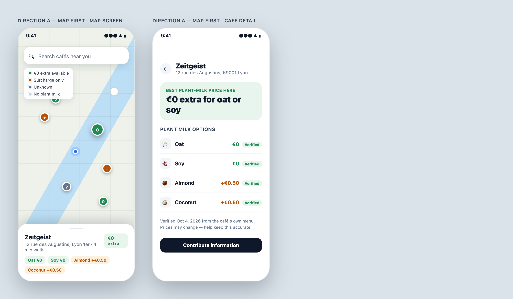
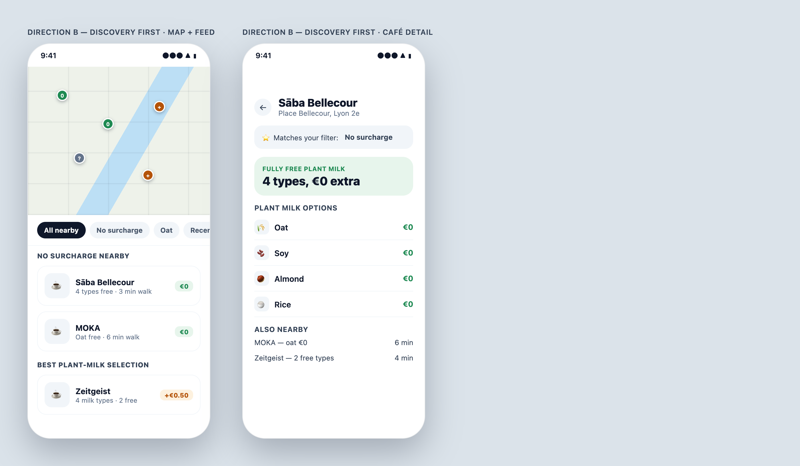
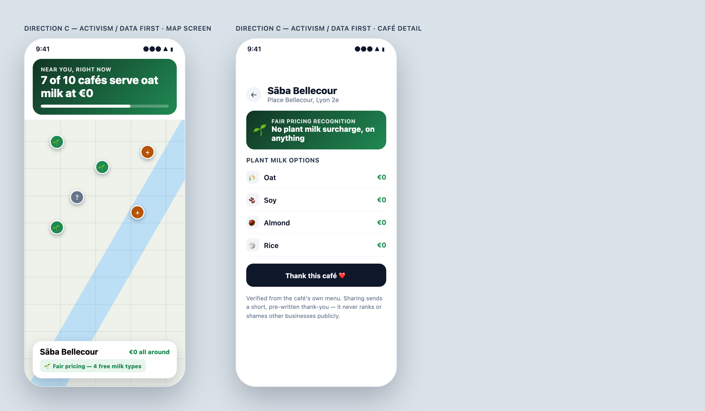
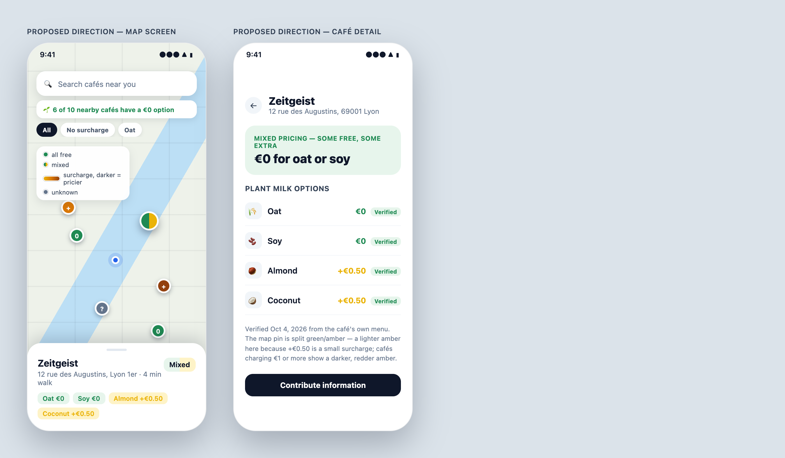

# First Milk app experience — design exploration

Explores issue [#9](https://github.com/KevinTss/milk-project/issues/9): three-plus visual/product directions for the core journey (open app → map of nearby cafés → understand plant-based friendliness and €0-vs-surcharge at a glance → tap a café → see milk types and pricing).

No external AI design tool (ChatGPT, Google Stitch, Figma AI) was available in this session, so the directions below were built directly as HTML/CSS mobile mockups, rendered to PNG, and grounded in the real `Place`/`VerifiedDetail` shapes from `packages/domain` and the actual Lyon dataset in `apps/api/data/places.json`. One café without plant milk ("Le Comptoir Lumière") is invented for the map legend, since all 10 real Lyon entries currently have plant milk available — everything else uses real café names, milk types and surcharges.

Scope stayed to the map and café-detail screens only, per the issue.

---

## Direction A — Map first

Full-bleed map (close to the current V1 MapLibre screen), colored pins carry the whole signal, tapping a pin opens a compact bottom sheet, tapping the sheet opens full detail.

**What I like**
- Closest to what's already shipped — small delta from today's `cafe-map.tsx`/`place-marker.tsx` to ship.
- The pin color/shape does all the work; no extra chrome competes with the map.
- The legend chip makes the 4-state color code (€0 · surcharge · unknown · none) learnable in one glance.

**What I don't like**
- A first-time user still has to read the legend once before colors mean anything — not "immediately understand" on the very first open.
- A pin with a single dominant color hides the fact that a café can be a *mix* (e.g. Zeitgeist: oat/soy free, almond/coconut +€0.50). The bottom sheet recovers this, but the map itself overstates simplicity.
- No sense of the broader picture ("how is my neighborhood doing") — purely transactional.

**Ideas worth keeping**
- The pin shape/size convention (plain filled dot, bigger + ring when selected) — cheap to implement on top of the existing `PlaceMarker`.
- Compact bottom sheet as the tap target before full detail, so browsing the map doesn't constantly full-navigate.

**Questions**
- If a café has both free and paid milk types, should its pin show green (best case), amber (worst case), or something else? Resolved below, in favor of a split pin.

---

## Direction B — Discovery first

Map is secondary (top ~35% of the screen), filter chips ("No surcharge", "Oat", "Recently verified") drive a scrollable card feed below it, grouped into curated shelves ("No surcharge nearby", "Best plant-milk selection").

**What I like**
- Genuinely useful for the "I don't have a café in mind yet, just show me good options" case — closer to how people actually use discovery apps.
- Filter chips map directly onto existing domain fields (`milkTypes`, surcharge `kind`) — no new backend concepts needed.
- The detail screen's "Matches your filter" line and "Also nearby" list reuse the same ranking logic as the feed, so it doesn't feel bolted on.

**What I don't like**
- Demotes the map, which undercuts the "this is a map-based discovery tool" framing from the mission doc and from issue #9 itself.
- More surface area to build for a V1 (shelves, chip filtering, card components) than the other directions.
- Shelves imply curation/ranking decisions (what counts as "best selection"?) that don't exist yet in the data model.

**Ideas worth keeping**
- The filter chip row (even just "No surcharge" as a single toggle) is a cheap, high-value addition on top of Direction A's map.
- "Also nearby" cross-links on the detail screen are a nice low-cost way to surface alternatives without a separate list screen.

**Questions**
- Is a curated-shelf home screen in scope for V1, or is a single filter toggle on the map enough for now?

---

## Direction C — Activism/data first

A green stat banner ("7 of 10 cafés serve oat milk at €0") sits above the map, pins use a leaf icon instead of a plain dot, and the detail screen for a €0 café shows a "Fair pricing recognition" ribbon and a "Thank this café ❤️" action.

**What I like**
- Most directly expressive of the mission in `docs/project.md` — turns browsing into a small moment of collective-action feedback, which no other direction does.
- The one-line stat is a genuinely good "immediately understand" device — it answers "how friendly is this neighborhood" before a single pin is tapped.
- "Thank this café" is a low-risk way to let users feel the activism angle without exposing anything punitive or public-facing.

**What I don't like**
- The "ribbon"/recognition mechanic implies a scoring or badge system that `docs/project.md` explicitly places *beyond* the first app (scorecards, recognition tooling are listed as long-term direction, not V1).
- Risk of feeling preachy or moralizing to a user who just wants a coffee — leaf icons and "fair pricing" copy lean activist in a way that could read as judgmental about the cafés that *do* charge extra.
- Builds a specific narrative ("thank this café") that doesn't have a clear data/backend story yet (what does thanking actually do?).

**Ideas worth keeping**
- The single aggregate stat line ("X of Y nearby cafés…") — frames the mission without requiring any new mechanic, just a computed count over what's already on screen.
- Leaning on green/leaf as the "good" visual language reinforces the color convention from Direction A rather than fighting it.

**Questions**
- How far should V1 lean into the activism framing vs. staying purely practical? Resolved below, in favor of the restrained middle ground (stat line only).

---

## Proposed direction

Combines, rather than picks:

- **From A**: the map stays primary and full-bleed; pins are plain colored dots (not icons/badges); tap → compact bottom sheet → tap again → full detail. This is the smallest delta from the current MapLibre implementation.
- **Pin color, resolved with Kevin**: a 5-state convention — solid green (all milk types free), **split green/amber** (mixed, e.g. Zeitgeist: oat/soy free, almond/coconut +€0.50), solid amber (surcharge on everything), gray (unknown), outline (no plant milk). The split pin was Kevin's call over "best case wins" or "worst case wins" — it shows the mix honestly without requiring a tap, at the cost of one more visual state to design (a two-tone marker instead of a plain dot).
- **Amber is a 3-step scale, not one color**: gold (≤€0.50), orange (€0.51–€0.99), deep brown (≥€1.00) — so a pin communicates roughly *how much* extra, not just *that* there's a surcharge. For a café with several paid milk types (e.g. Slake Terreaux: oat +€0.50, coconut +€0.70), the pin uses the **highest** surcharge among them, as a "most you might pay here" signal. Real thresholds from the Lyon data: Zeitgeist/Caillou/Joséphine/Slake-oat sit at €0.50 (gold), Slake-coconut at €0.70 (orange), Nuage Café and Café Bacatá at €1.00 (brown). The map legend shows this as a small gradient swatch rather than three separate dots, to keep the legend compact.
- **From B**: a single filter toggle ("No surcharge") sits under the search bar — one chip, not a whole shelf system — plus the detail screen's "nearby alternatives" line when a café isn't the cheapest option.
- **From C, kept restrained per Kevin**: one computed stat line ("🌱 6 of 10 nearby cafés have a €0 option") above the map — the mission signal, with no ribbons, no scoring, no "thank this café" mechanic. Nothing here needs product concepts beyond what `packages/domain` already models.
- Detail screen keeps A's structure (hero badge, per-type rows with price + verification chip, verification footnote, "Contribute information" CTA for reported/unknown data) since none of the other directions improved on it.

This is what I'd actually build next, pending the remaining open question below.

---

## Decisions made during this exploration

Asked directly, Kevin chose:

1. **Pin color for mixed cafés** → **split/dual-tone pin**, not "best case" or "worst case" wins. Reflected above and in the mockup's legend (all free / mixed / surcharge / unknown).
2. **Activism framing** → **restrained**: keep the one computed stat line, skip the recognition ribbon and "thank this café" mechanic from Direction C for V1.
3. **Amber shouldn't be one color** — Kevin asked for the surcharge color itself to vary by size, not just mark "surcharge vs. not." → amber is now a 3-step gold/orange/brown scale keyed to the surcharge amount (see the proposed-direction section above for thresholds and the max-surcharge rule for multi-type cafés).

## Still open

- **Detail-screen depth**: is the per-milk-type row list (icon, price, verification chip) the right amount of detail for V1, or should evidence/sourcing (the `Evidence[]` on each `VerifiedDetail`) be visible directly on this screen rather than only implied by the verification chip?

## Not addressed here

Onboarding, search, supermarkets/retail, scorecards, and any contribution-form UI are out of scope for this exploration, per the issue.
